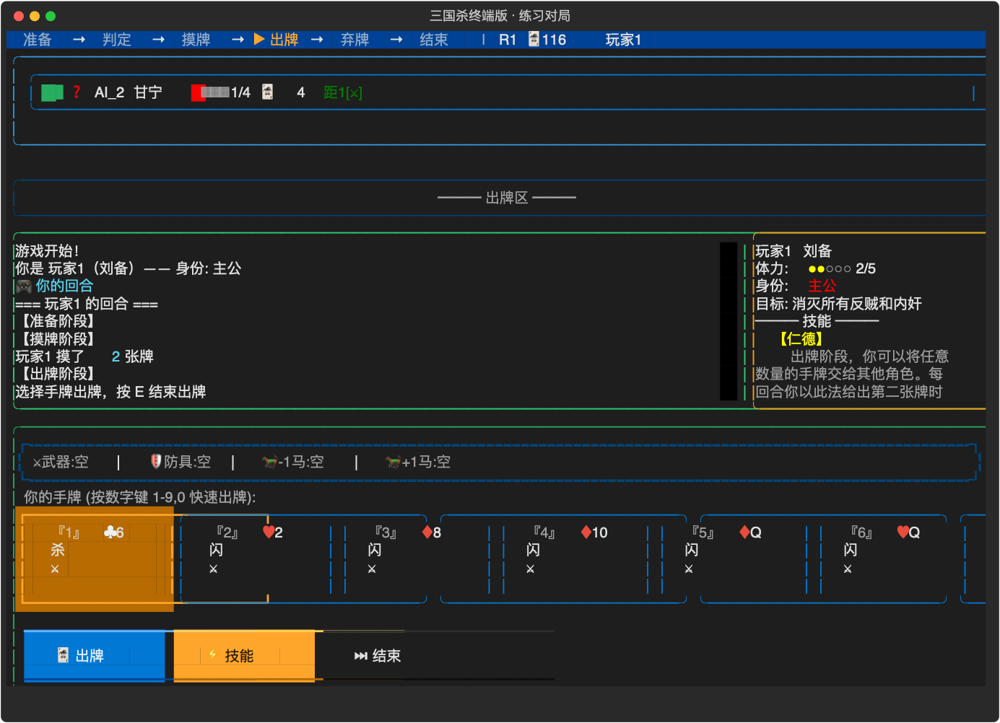
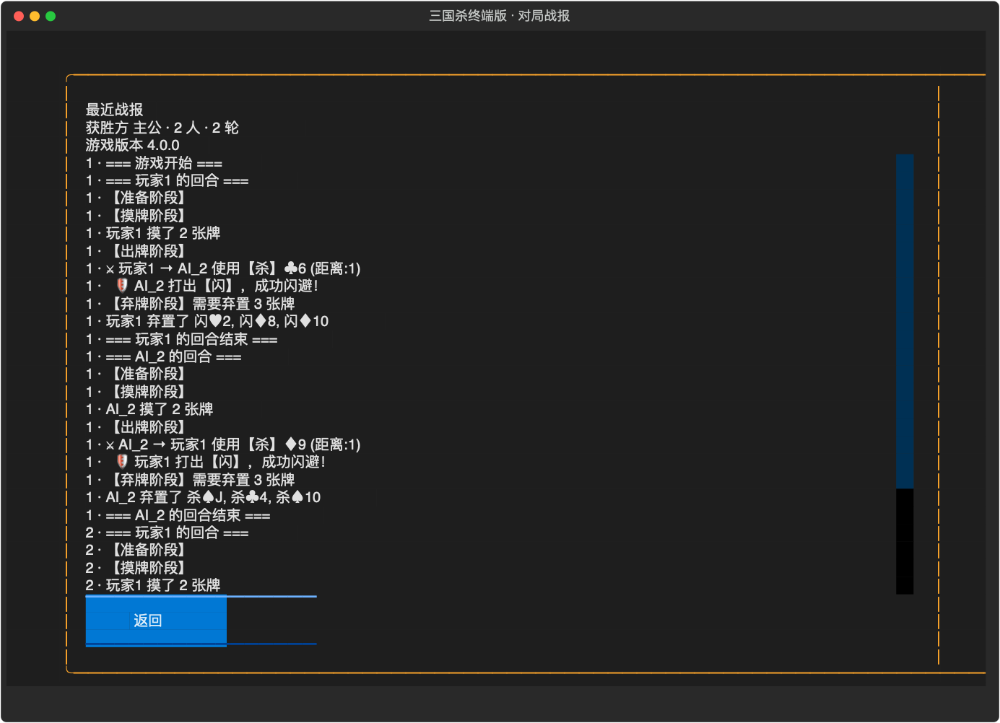

# 三国杀终端版


在终端打一局三国题材的身份卡牌游戏。选武将、用手牌和技能推进回合，按主公、忠臣、反贼或内奸的目标争取胜利。支持 **2–8 人单机身份局**、**三档 AI** 和 **键盘练习局**。

[下载 Apple Silicon 版](https://github.com/Nevergoodstudy/sanguosha-zhongduanban/releases/latest) · [新手指南](docs/playing.md) · [战报与局域网内测](#战报与局域网内测) · [开发与验证](#开发与验证)

## 快速开始

### Apple Silicon Mac

从发布页下载 `sanguosha-4.0.0-macos-arm64`。如果文件在「下载」文件夹，打开「终端」执行下面的命令。独立成品无需安装 Python。[下载页与校验文件](https://github.com/Nevergoodstudy/sanguosha-zhongduanban/releases/tag/macos-2026.11.26)

```sh
cd ~/Downloads
chmod +x sanguosha-4.0.0-macos-arm64
./sanguosha-4.0.0-macos-arm64
```

### 从源码运行

使用 Python 3.10 或更高版本及 UTF-8 终端。macOS、Windows、Linux 均可使用源码方式。

```sh
git clone https://github.com/Nevergoodstudy/sanguosha-zhongduanban.git
cd sanguosha-zhongduanban
python -m pip install .
sanguosha
```

## 第一局怎么打

在主菜单选 **练习局**。固定起手会依次带你体验出「杀」、选目标、弃牌、用「闪」响应和对局结算。打完可打开最近战报，或者立即重开。



| 按键 | 操作 |
|---|---|
| `1`–`9`、`0` | 选择对应顺序的手牌，`0` 选择第十张 |
| `Tab`、`Shift+Tab` | 在卡牌、目标和按钮间移动焦点 |
| `Enter` | 确认当前选项 |
| `Esc` | 取消目标选择或拒绝常用响应 |
| `E` | 结束出牌 |
| `H` | 查看规则 |
| `Q`、`Ctrl+Q` | 退出对局 |

熟悉操作后选 **开始新游戏**，设置玩家数、AI 难度和身份偏好。标准身份局支持延时锦囊判定、装备与攻击距离、连锁「无懈可击」和濒死救援。规则和示例指令见[新手指南](docs/playing.md)。

## 战报与局域网内测

**战报**。结算后可回顾胜方、轮数和摸牌、出牌、响应、弃牌等事件。主菜单保留最近一局的入口。源代码安装后也可通过命令行导出和重读。

```sh
sanguosha --latest-report > report.json
sanguosha --replay report.json
```

<details>
<summary>查看实际战报截图</summary>



</details>

**联机内测**。使用终端命令建房、加入、准备、选将和出牌。双客户端已在同一台 Mac 上验证出牌响应、断线恢复和结算。[局域网启动与客户端命令](docs/playing.md#局域网内测)

## 📖 游戏规则

### 身份与胜利条件

| 身份 | 胜利条件 |
|------|----------|
| 👑 主公 | 消灭所有反贼和内奸 |
| 忠臣 | 保护主公获胜 |
| 反贼 | 消灭主公 |
| 内奸 | 最后存活 |

### 回合流程

1. **准备阶段** — 触发准备阶段技能（观星等）
2. **判定阶段** — 处理判定区延时锦囊（后放先判）
3. **摸牌阶段** — 从牌堆摸 2 张牌
4. **出牌阶段** — 使用手牌和技能（每回合限 1 张杀，特殊情况除外）
5. **弃牌阶段** — 手牌超过体力值须弃牌
6. **结束阶段** — 触发结束阶段技能

## 🃏 卡牌一览

### 基本牌
杀、火杀🔥、雷杀⚡、闪、桃、酒🍺

### 锦囊牌
决斗、南蛮入侵、万箭齐发、无中生有、过河拆桥、顺手牵羊、借刀杀人、桃园结义、无懈可击、铁索连环🔗、乐不思蜀、兵粮寸断、闪电

### 装备牌
- **武器**：诸葛连弩(1)、寒冰剑(2)、古锭刀(2)、青龙偃月刀(3)、丈八蛇矛(3)、贯石斧(3)、方天画戟(4)、朱雀羽扇(4)、麒麟弓(5)
- **防具**：八卦阵、仁王盾、藤甲🌿、白银狮子
- **坐骑**：赤兔(-1)、大宛(-1)、紫骍(-1)、的卢(+1)、爪黄飞电(+1)、绝影(+1)

## 👥 武将列表（20+）

**蜀**：刘备(仁德/激将)、关羽(武圣)、张飞(咆哮)、诸葛亮(观星/空城)、马超(马术/铁骑)、黄月英(集智/奇才)、魏延(狂骨)

**魏**：曹操(奸雄/护驾)、司马懿(反馈/鬼才)、夏侯惇(刚烈)、张辽(突袭)、徐晃(断粮)、曹仁(据守)

**吴**：孙权(制衡/救援)、周瑜(英姿/反间)、大乔(国色/流离)、吕蒙(克己)、甘宁(奇袭)、黄盖(苦肉)、孙尚香(结姻/枭姬)

**群**：吕布(无双)、华佗(青囊/急救)、貂蝉(离间/闭月)

## 开发与验证

| 路径 | 内容 |
|---|---|
| `game/`、`data/` | 回合、卡牌、技能、武将和战报 |
| `ui/textual_ui/`、`i18n/` | Textual 界面、中英文翻译 |
| `ai/`、`net/` | AI 策略和 WebSocket 局域网内测 |
| `tests/`、`tools/` | 回归、打包和冒烟验证 |

```sh
python -m pip install ".[dev]"
python -m pytest tests/ --randomly-seed=42
```

在目标平台使用 Python 3.12 构建。下面的示例适用于 Apple Silicon，最后一条命令检查架构、签名、标准身份局启动和完整练习局。

```sh
python -m pip install ".[build]"
python build.py --name sanguosha-4.0.0-macos-arm64
python tools/macos_smoke.py dist/sanguosha-4.0.0-macos-arm64
```

构建脚本保留已有同名成品。用 `--output-dir` 指定新目录或用 `--name` 更换名称。为 Python 发行包安装 `build` 后运行 `pyproject-build`。

2026 年 11 月 26 日发布的游戏版本通过了 1,545 项本地测试。GitHub 上的 macOS、Windows、Linux 测试与构建任务通过，MyPy 和 Bandit 仍报告问题。[本地验收](docs/macos-improvement-plan.md) · [GitHub Actions](https://github.com/Nevergoodstudy/sanguosha-zhongduanban/actions/runs/45766844679)

欢迎通过 Issue 提交反馈。涉及对局行为时，可以附上系统版本、复现步骤和相关战报。[贡献指南](CONTRIBUTING.md) · [提交 Issue](https://github.com/Nevergoodstudy/sanguosha-zhongduanban/issues/new)

## 文档

- [Mac 改进计划与验收](docs/macos-improvement-plan.md)
- [项目审查报告](docs/project-review-2026-11-24.md)
- [开发与调研资料](docs/research/README.md)
- [项目架构](ARCHITECTURE.md)
- [更新记录](CHANGELOG.md)

## 项目声明

这是独立的社区项目。项目元数据沿用 MIT 声明，现有仓库未提供独立的 LICENSE 文件。三国杀为游卡桌游的商标。

封面为原创生成插画。练习局与战报图片由实际运行的 Textual 界面导出。
